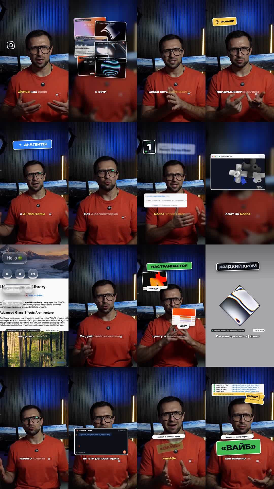
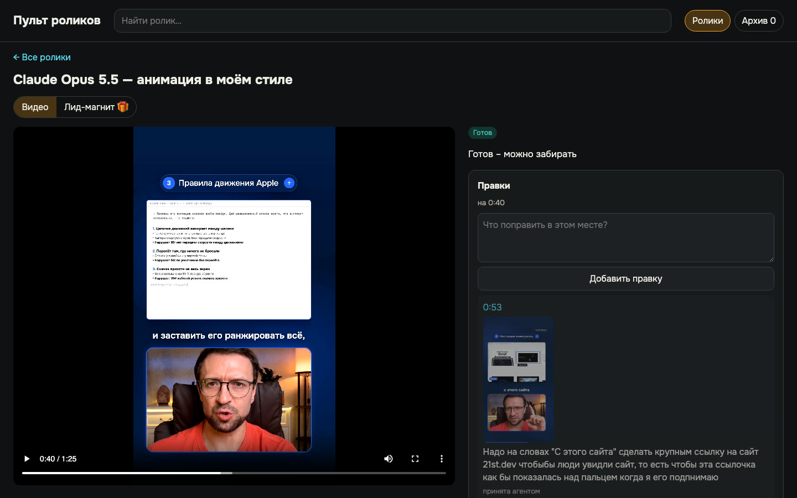
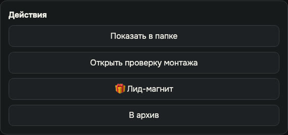

# Урок 6. Финал, который совпадает с утверждённым

Знакомая история: утвердили одну версию, а выложили другую. Где-то проскочил старый файл, где-то
при экспорте поплыл звук, и заметили это уже по комментариям.

Здесь так не будет. Финал - это тот самый файл, который вы посмотрели и утвердили: пульт копирует
его за секунды и сверяет по SHA-256. Второй сборки нет, поэтому и поплыть нечему. А движок в фоне
ещё раз проверяет готовый ролик - и на слух, и по кадрам.

**Результат урока:** проверенный финальный файл у вас на телефоне, готовый к выкладке.

**В этом уроке мы:**

- разберёмся, откуда берётся финал после «Утверждаю»;
- разберём проверки простыми словами;
- заберём файл так, чтобы он не потерял качество;
- поймём, что делать, если в финале всё-таки нашлась ошибка;
- узнаем, когда нужна кнопка «Финал не нужен»;
- освободим место на диске после финала.

**Время:** 5 минут ваших. Финал появляется через несколько секунд после «Утверждаю». Фоновая
проверка для рилса занимает ещё примерно 1-2 минуты, но забирать файл можно сразу.

---

## Смотрите: вот так агент отчитывается

Это настоящий отчёт по ролику «Дизайн-репозитории GitHub». Тогда финал ещё собирался отдельным
рендером, и агент проверил его сам, без моей просьбы. Сейчас рендером собирают только фрагмент, 4K,
устаревший preview или ролик, который не удалось скопировать. Но читать отчёт полезно всегда:

| Проверка | Результат |
|---|---|
| Формат | 1080×1920, 25 кадров в секунду |
| Длительность | 84,36 с - ровно как у утверждённой версии |
| Файл | проигрывается целиком, без битых кадров |
| Громкость | −14,7 LUFS, пики −1,2 дБ |
| Картинка против утверждённой | совпадает |
| Голос против исходного видео | сдвиг 0 мс в начале, середине и конце |

А это контакт-лист: кадры по всему ролику на одной картинке. Одного взгляда хватает, чтобы
увидеть весь ролик и убедиться, что нигде нет пустого или битого кадра.

---

## Шаг 1. Финал появляется сам

**Зачем.** Раньше после «Утверждаю» нужно было передать фразу агенту и ждать второй сборки. Теперь
полный preview с самого начала собирается в качестве финала, и после вашего «Утверждаю» пульт
просто копирует его в финал.

**Что вы делаете.** Ничего: «Утверждаю» вы уже нажали в [уроке 5](05-pult.md#шаг-7-утверждаем-).
Пульт ответил «Финал готов - можно забирать», карточка в разделе **«Готов»**.

Финал появляется только после вашего «Утверждаю» - даже если все проверки движка на preview были
зелёными. Проверки ищут ошибки, а решение, что ролик готов, принимаете вы.

**Что делает движок.**

1. Сверяет preview по SHA-256: это ровно тот файл, который вы смотрели, для той же версии ролика.
2. Копирует его в папку `final/` - за секунды, без второго рендера. Ничего нового не добавляет.
3. В фоне запускает проверку финала. Её состояние - строка под статусом карточки (урок 5, шаг 7).

**Если карточка встала в «В работе»** с подписью «Утверждено - агент собирает финал», значит, этот
preview нельзя было сразу сделать финалом: вы утверждали фрагмент, ролик в 4K, preview устарел
или копирование не удалось. Скопируйте фразу из пульта в чат - тот же, где делали ролик, или
новый, открытый в папке движка. Такой финал собирается рендером: агент проверит его и пришлёт
отчёт, как в примере выше.

**Пока ждёте проверку** - закажите лид-магнит, если пульт уже спросил «🎁 Лид-магнит?»
([урок 7](07-lead-magnet.md)).

---

## Шаг 2. Читаем отчёт простыми словами

**Зачем.** Разбираться в цифрах не обязательно: достаточно, чтобы агент написал «все проверки
пройдены». Но полезно понимать, за что он ручается.

Отчёт бывает двух видов. Финал из preview - обычный случай - получает только фоновую проверку
(ниже). Отчёт как в примере выше агент присылает, когда финал собран рендером: фрагмент, 4K,
устаревший preview или копирование не удалось.

**Отчёт о финале, собранном рендером:**

| Проверка | Что это значит | Какой результат нормальный |
|---|---|---|
| Формат | размер и частота кадров | вертикаль 1080×1920 или горизонталь 1920×1080, 25 или 30 кадров |
| Файл | открывается ли целиком | без битых кадров |
| Громкость (LUFS) и пики | средняя громкость ролика и самые громкие мгновения звука | около −14…−15 - обычный уровень соцсетей, ролик не будет тише или громче соседних; пики не выше −1,5 дБ, иначе после пережатия в соцсетях звук хрипит |
| Совпадение с preview (только у финала рендером) | та же ли картинка, что вы утвердили | совпадает |
| Синхрон (только у финала рендером) | не сдвинулся ли голос относительно исходного видео | 0 мс в начале, середине и конце |
| Контакт-лист | кадры по всему ролику | без обрывов и пустых кадров |
| SHA-256 | «номер кузова» файла, как VIN у машины | по нему можно убедиться, что выкладываете именно проверенный файл |

У финала из preview «совпадения» и «синхрона» нет - и не нужно: это тот же файл, который вы
смотрели, сверенный по SHA-256. Громкость выставлена той же финишной обработкой, что и у рендера.

**Фоновая проверка финала** смотрит на готовый ролик ещё раз - и на слух, и по кадрам. Движок
заново расшифровывает речь и сверяет её с тем, что должно звучать, а потом проверяет обложку и
надписи. Отчёт выглядит как список из восьми строк, у каждой ✅, ⚠️ или ⏭️ (не проверялось):

| Строка отчёта | Что ищет |
|---|---|
| F1. Слова-паразиты в финале | «ну», «ээ», «типа», «короче» в речи |
| F2. Лишние куски (дубли) | повтор фразы, который не вырезали |
| F3. Пропавшие и обрезанные слова | слово из текста пропало или обрезано склейкой |
| F4. Длинные паузы | слишком долгая тишина между словами |
| F5. Звук без слов (вздохи) | вздох или шум без речи |
| G13. Обложка - кадр 0 | первый кадр не чёрный и не пустой: его соцсети берут превью |
| G14. Текст за краем | надпись не уходит за безопасную зону и не обрезана |
| G15. Наложение надписей | надписи не наезжают друг на друга |

Всё это - только предупреждения: финал готов в любом случае, ни одна строка его не забирает. У
ролика без речи, например промо под музыку, строк F1-F5 нет: расшифровывать там нечего. У роликов
без съёмки и промо надписи фоновая проверка не замеряет: у G14 и G15 в отчёте стоит ⏭️. Проверьте
надписи глазами при просмотре preview. Строка «Проверка финала нашла замечания» значит: передайте
агенту фразу из пульта, он прочитает отчёт и скажет, стоит ли делать новую версию.

---

## Шаг 3. Забираем файл

**Что вы делаете.** В пульте откройте карточку и нажмите **«Показать в папке»**. Финал лежит в
папке ролика: `projects/<папка ролика>/final/<название>.mp4`. У двух вариантов темы две папки и
два финала: перед «Показать в папке» переключите вкладку варианта над плеером.

Кнопка «Показать в папке» - в блоке «Действия» ниже правок:

**Как перенести на телефон без потери качества:** AirDrop, кабель или облако. Через Telegram -
только **как файл**, а не как видео, иначе мессенджер пережмёт ролик.

### Что мы уже сделали

Получили финал сразу после «Утверждаю», разобрали проверки и забрали файл на телефон. Осталось
знать, что делать, если ошибка нашлась уже в финале, и освободить место на диске.

---

## Шаг 4. Если в финале что-то не так

Финал собран из утверждённой версии и проверен. Заметили ошибку - это новая правка, по тому же
кругу, что в уроке 5:

1. Оставьте правку в пульте на нужной секунде.
2. Нажмите «Скопировать для агента» и вставьте фразу в чат.
3. Посмотрите новую версию и утвердите заново.
4. Пульт так же за секунды положит новый финал. Файл в папке `final/` заменится новым, а прежний
   останется в «Истории» пульта.

Нашли в финале оговорку, которую надо вырезать из речи, - это полный круг: новый исходник, новый
слой анимаций и новое утверждение. Поэтому такие места лучше ловить ещё на черновой нарезке
([урок 5](05-pult.md#шаг-2-черновая-нарезка)).

---

## Шаг 5. Если финал не нужен

Бывает, что вы утвердили ролик, а финал собирается рендером - фрагмент, 4K, устаревший preview
или копирование не удалось, - и тут вы передумали. Например, тему сняли с публикации. Тогда агент
будет каждый раз видеть во входящих «Утверждено» и ждать, что финал нужен.

**Что вы делаете.** В блоке «Действия» карточки нажмите тихую кнопку **«Финал не нужен»** и
подтвердите. Карточка перейдёт в «Готов» с подписью «Финал не нужен», и агент перестанет ждать
этот финал. Передумали - кнопка **«Вернуть: собрать финал»**. А если вы утвердите новую версию
того же ролика, финал снова понадобится, и агент его соберёт.

После «Вернуть: собрать финал» пульт подскажет скопировать фразу для агента - финал в этом случае
собирается рендером, а не копированием. Вставьте фразу в чат.

Кнопка есть только у утверждённой версии, у которой ещё нет финала. После обычного «Утверждаю»
финал появляется за секунды, поэтому чаще всего вы эту кнопку просто не увидите.

Можно сказать и в чате: «Финал ролика «<название>» не нужен». Агент запишет это решение, но только
по вашим словам - сам он его не принимает.

---

## Шаг 6. Освобождаем место на диске

**Зачем.** Каждая правка оставляет промежуточные сборки и копии записи. За месяц роликов они
съедают десятки гигабайт, а ноутбук с полным диском начинает собирать медленнее или вовсе
останавливается.

**Что делает агент.** После финала и фоновой проверки он сам предложит чистку этого ролика:
напишет, сколько гигабайт освободится, и покажет список файлов. Ничего не удаляет, пока вы не
ответите «да».

**Что вы делаете.** Посмотрите список и ответьте «да» или «нет». Хотите почистить ролик позже -
скажите: «Почисти ролик «<название>»: покажи, что удалишь и сколько места освободится».

Финал, текущее ТЗ, слой анимаций текущей версии, исходники записи и лид-магнит чистка не трогает.
Уходят только старые промежуточные сборки, которые больше ни на что не ссылаются.

---

## Итог урока

Что мы сделали:

- получили финал сразу после «Утверждаю», без второй сборки;
- разобрали проверки простыми словами;
- забрали файл на телефон без потери качества;
- поняли, как исправить ошибку в финале;
- узнали, когда нужна кнопка «Финал не нужен»;
- почистили диск после финала - только после своего «да».

## Грабли

| Что случилось | Как избежать |
|---|---|
| Финал, собранный рендером, выглядел не так, как утверждённый preview | Агент собрал его с другими настройками оформления. Это ловит проверка «совпадение с preview». Если агент о ней не написал - спросите. У финала из preview такого не бывает: это тот же файл |
| Карточка утверждена, но стоит в «В работе», а не в «Готов» | Фрагмент, 4K, устаревший preview или копирование не удалось: такой финал собирает агент. Скопируйте фразу из пульта и отправьте в чат |
| После утверждения попросили музыку громче | Это новая версия и новое утверждение ([урок 5](05-pult.md#шаг-7-утверждаем-)) |
| Агент написал «Можно освободить N ГБ» - и вы решили, что он уже удалил | Это только подсказка с размером. Без вашего «да» агент ничего не удаляет |

## Домашнее задание

**Сделайте:** заберите финал своего ролика и перенесите его на телефон.

**Проверьте себя:**

- [ ] карточка в разделе «Готов»;
- [ ] строка под статусом - «Проверка финала пройдена», а если есть замечания, агент их посмотрел;
- [ ] вы посмотрели финал на телефоне, в том размере, в каком его увидит зритель, и со звуком;
- [ ] на предложение чистки вы ответили сами - «да» или «нет».

---

**В следующем уроке** выполним обещание из концовки: соберём страницу, которую зритель получит по
кодовому слову, - в вашем стиле и проверенную, как финал: [урок 7](07-lead-magnet.md).
