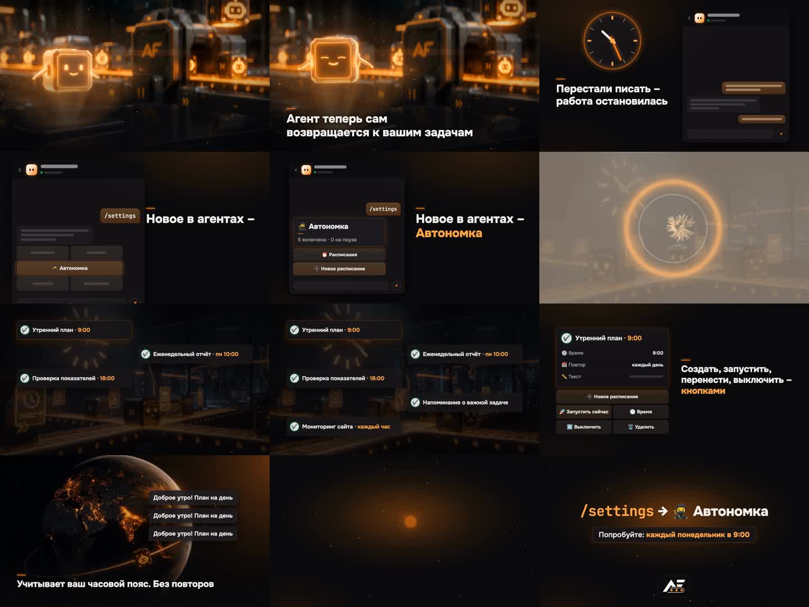

# Урок 11. Сквозной пример: промо 16:9 за вечер

В уроках 4-10 мы с вами разобрали каждый шаг по отдельности. Здесь соберём их в одну историю: как
один настоящий ролик прошёл весь путь от первой фразы агенту до финала на диске.

Ролик - анонс функции «Автономка» в Agent Factory для поста в канале. Горизонтальный 16:9,
30 секунд, без голоса, под музыку. Одна версия. Мы сделали его 19-20 октября 2026 года. Все цифры,
правки и ошибки ниже - из этого прогона, ничего не придумано.

> Это не юридическая консультация. Условия сервисов, музыкальных библиотек и правила площадок
> меняются, поэтому перед публикацией сверяйтесь с их текущими версиями.

**Результат урока:** вы видите целиком, как выглядит промо 16:9 от карточки «Что делаем?» до
чистки диска: где ваши решения, где ждёт агент и сколько это стоит.

**В этом уроке мы:**

- ответим на карточку «Что делаем?» для горизонтального промо;
- утвердим смету Higgsfield и получим три кинокадра;
- покажем в ролике настоящий экран продукта;
- поменяем музыку на живой трек из Mixkit;
- посмотрим, как критик поднял оценку с 7,5 до 9,0;
- разберём рендер, остановку проверки и финал после «Утверждаю»;
- почистим диск.

**Время:** ваших - несколько коротких ответов в чате и просмотр ролика в пульте. Рендер на Mac -
около двух минут. Остальное - ожидание генерации.

---

## Смотрите: что получилось

12 кадров готового ролика по порядку: голограмма-робот на фабрике, проблема, экран продукта,
расписания, кнопки, часовой пояс и концовка с призывом.

| Что | Сколько |
|---|---|
| Формат | 1920×1080, 30 кадров в секунду, 30 секунд |
| Сцены | 7, из них 3 с кинокадрами Higgsfield |
| Кредиты Higgsfield | около 108,5 |
| Оценка критика по кругам | 7,5 → 8,9 → 9,0 |
| Рендер на Mac (M1 Pro) | подготовка анимаций - 64 секунды, рендер ролика - 52 секунды |
| Размер финала | 8,4 МБ (2,2 Мбит/с) |
| Финал после «Утверждаю» | за секунды, копия просмотренного ролика |

---

## Шаг 1. Карточка «Что делаем?»

**Зачем.** Одна точка решения в начале: дальше агент работает сам и не спрашивает про шрифты,
цвета и тайминги ([урок 4](04-montage.md#шаг-3-выбираем-маршрут-карточка-что-делаем)).

**Ответы для этого ролика:**

| Вопрос | Ответ |
|---|---|
| «Что делаем?» | рекламный промо под музыку |
| «Формат?» | горизонталь 16:9 - ролик для поста |
| «Из чего собираем?» | без съёмки - тема, текст или музыка |
| «Как монтируем?» | Creative Motion + оверлеи Higgsfield |

В нашем прогоне карточки не было: в запросе уже были формат, длина и тип ролика, поэтому агенту
нечего было уточнять. Если в вашем запросе чего-то не хватит, агент спросит карточкой только
недостающее.

**Что сказать агенту:**

> Сделай AI-промо без голоса на 30 секунд: анонс функции <название> для поста в канале.
> Горизонталь 16:9. Тексты на экране бери только из моего поста: <текст поста>. Стиль - цвета
> продукта. Сначала покажи надписи и раскадровку, потом посчитай стоимость плана.

**Что сделал агент.** Взял цвета мини-приложения Agent Factory: тёмный фон и оранжевое свечение.
Логотипа автора не было, поэтому в концовку пошёл знак продукта. Тексты - только из поста, не
больше 6-8 слов на экран, всего 7 сцен.

---

## Шаг 2. Смета Higgsfield и «да» ✋

**Зачем.** Кредиты - это деньги. Агент ничего не генерирует, пока вы не утвердили смету
([урок 10, шаг 3](10-ai-promo.md#шаг-3-раскадровка-музыка-и-бюджет-)).

**Что было у нас.** На балансе 787 кредитов, тариф Plus. Агент спросил у Higgsfield цены и показал
смету до первой генерации, и только после нашего «да» на эту смету начал тратить:

| Что | Модель | Кредиты |
|---|---|---|
| Ключевые кадры: 3 кадра по 2 варианта, по референсу картинки из мини-приложения | Nano Banana | около 6 |
| Оживление: 3 клипа по 5 секунд без звука | Kling 3.0 pro | 22,5 |
| Второй вариант главной вставки: 5 секунд, 1080p | Seedance 2.5 | 80 |
| **Итого** | | **около 108,5** |

**Фраза для подписи:**

> Утверждаю бюджет на весь план по твоей смете: <кредиты по партиям>, всего не больше <итог>.

Если хотите остановиться после дешёвой части, утверждайте по партиям, как в
[уроке 10](10-ai-promo.md).

---

## Шаг 3. Три кинокадра

**Что делает агент.** Сначала дешёвые ключевые кадры, потом видео из выбранных. Главную вставку -
голограмму-робота - агент сделал в двух моделях: в Kling и в Seedance.

**Что выбрали мы.** Голограмму от Seedance: у неё робот моргает, и кадр сразу живой. Остальные
два плана - от Kling. Дорогой второй вариант мы заказали только для одного главного кадра, а не
для всех трёх.

Не хотите выбирать сами - скажите «выбери сам», агент объяснит выбор.

---

## Шаг 4. Настоящий экран продукта

**Зачем.** Зритель должен узнать то, что увидит у себя. Нарисованный «примерно такой» интерфейс
вызывает вопрос «а где это?».

**Что сделал агент.** Нарисовал экран «Автономки» по настоящему коду бота: те же названия кнопок -
«Расписания», «Новое расписание», «Запустить сейчас», «Выключить», «Удалить». Это не скриншот, а
графика движка, поэтому её можно анимировать: расписания появляются по одному.

**Что сказать агенту,** если в вашем продукте есть интерфейс:

> Экран продукта рисуй по настоящему интерфейсу: <скриншоты или где лежит код>. Названия кнопок -
> дословно.

---

## Шаг 5. Музыка: живой трек из Mixkit

**Что было.** Сначала агент поставил музыку, которую сгенерировал движок. Нам захотелось живого
звука:

> Музыка не та. Хочу живой хип-хоп - предложи несколько треков на выбор.

**Что сделал агент.** Предложил 5 треков Mixkit по 30 секунд. Выбрали «Hip Hop 02». Агент свёл его
со щелчками интерфейса и низкими ударами (саб-бумами).

**Про права.** По лицензии Mixkit Stock Music Free License треки можно ставить в ролики, в том
числе коммерческие, без отчислений. Но условия меняются: перед публикацией сверьтесь с условиями
на странице трека ([урок 9](09-publish.md#шаг-1-проверяем-источники)).

---

## Шаг 6. Критик: 7,5 → 8,9 → 9,0

**Зачем.** Критик смотрит кадры ключевых моментов до рендера видео и ставит оценки сценам
([урок 4](04-montage.md#шаг-4-что-делает-агент-пока-вы-ждёте)). Правка кадра стоит секунды, а
лишний рендер - минуты.

**Что было у нас.** Три круга: 7,5 → 8,9 → 9,0 - и стоп, оценка дошла до 9. За эти круги агент
поправил:

- пустые хвосты сцен - кадр уже сказал своё, а сцена ещё тянется;
- одинаковые соседние раскладки - две сцены подряд устроены одинаково;
- пять одинаковых вылетов карточек - глаз перестаёт их замечать;
- мелкий текст интерфейса - его не успеть прочитать.

Всё это - по кадрам, без единого рендера видео. Вы в этом шаге ничего не делаете.

---

## Шаг 7. Рендер и проверка, которая остановила сборку

**Что было.** Видео рендерилось на Mac с процессором M1 Pro и только после критика, а не после
каждого его круга. Анимации собрались один раз - 64 секунды. Сам ролик собирался дважды, по 52
секунды: первую сборку остановила проверка звука (ниже), вторая прошла.

Сборку остановила проверка движка: самый громкий миг звука был −0,4 дБ при норме −1,5.
Новый трек после сжатия перегружал. Плохой preview движок не показал. Агент сам пересвёл звук с
запасом, и проверки прошли: все зелёные.

Итог: 1920×1080, 30 кадров в секунду, 8,4 МБ (2,2 Мбит/с) - лёгкий файл для поста в канале.

**Вывод.** Такие остановки - не поломка, а работа проверок
([урок 10, шаг 6](10-ai-promo.md#шаг-6-сборка-и-проверка)). Вы видите только ролик, который их
прошёл.

---

## Шаг 8. «Утверждаю» - и сразу финал ✋

**Что вы делаете.** Откройте карточку в пульте, посмотрите ролик целиком со звуком, отметьте
«Я посмотрел preview целиком» и нажмите «Утверждаю» ([урок 5](05-pult.md#шаг-7-утверждаем-)).

**Что было у нас.** После «Утверждаю» финал появился за секунды - пульт скопировал тот самый
ролик, который мы смотрели. Отдельной финальной сборки не было. Фоновая проверка финала
ответила: всё хорошо, строка под карточкой - «Проверка финала пройдена».

---

## Шаг 9. Чистка

**Что делает агент.** После финала и проверки он сам предлагает чистку ролика: сколько гигабайт
освободится и какие файлы уйдут. Удаляет только после вашего «да». Финал и материалы текущей
версии чистка не трогает ([урок 6](06-final.md#шаг-6-освобождаем-место-на-диске)).

> Почисти ролик «<название>»: покажи, что удалишь и сколько места освободится. Удаляй только
> после моего «да».

---

## Итог урока

Что мы сделали:

- ответили на карточку «Что делаем?» одним разом;
- утвердили смету Higgsfield около 108,5 кредита до генерации;
- выбрали кинокадры: голограмму от Seedance, остальное от Kling;
- нарисовали экран продукта по настоящему интерфейсу;
- поменяли музыку на живой трек и проверили его условия;
- прошли критика 7,5 → 8,9 → 9,0 без рендера;
- собрали ролик, пережили остановку проверки звука и получили 8,4 МБ;
- нажали «Утверждаю» и получили финал за секунды;
- почистили диск после своего «да».

## Фразы агенту из этого урока

| Когда | Что сказать |
|---|---|
| Старт промо 16:9 | Сделай AI-промо без голоса на 30 секунд: <о чём>. Горизонталь 16:9. Тексты бери только из моего поста: <текст>. Стиль - цвета продукта. Сначала покажи надписи и раскадровку, потом посчитай стоимость плана. |
| Подпись под сметой | Утверждаю бюджет на весь план по твоей смете: <кредиты по партиям>, всего не больше <итог>. |
| Экран продукта | Экран продукта рисуй по настоящему интерфейсу: <скриншоты или код>. Названия кнопок - дословно. |
| Сменить музыку | Музыка не та. Хочу <жанр> - предложи несколько треков на выбор. |
| Чистка | Почисти ролик «<название>»: покажи, что удалишь и сколько места освободится. Удаляй только после моего «да». |

Больше фраз - в [шпаргалке](PROMPTS.md).

## Грабли

| Что случилось | Что делать |
|---|---|
| Сборку остановила проверка: звук громче нормы | Ничего не делайте: агент пересводит звук сам. Если остановка повторяется - спросите, что именно не прошло |
| Музыка, которую поставил агент, не нравится | Попросите живой трек и несколько вариантов на выбор, как в шаге 5. Условия трека проверьте на его странице |
| На экране слишком много слов | Не больше 6-8 слов на экран и только из вашего текста. Скажите: «Сцена <N>: сократи надпись до 6 слов из поста» |
| Дорогая модель на всех кадрах съедает бюджет | Дорогой вариант - только на главную вставку, остальное дешевле, как у нас: Seedance на один план, Kling на остальные |
| Интерфейс в ролике не похож на настоящий | Дайте агенту скриншоты или код и попросите названия кнопок дословно |

## Домашнее задание

**Сделайте:** промо 16:9 на 20-30 секунд для своего продукта или поста по этому уроку.

**Проверьте себя:**

- [ ] на карточку «Что делаем?» вы ответили один раз;
- [ ] смета утверждена до генерации, итог в неё уложился;
- [ ] тексты на экране - только из вашего поста, не больше 6-8 слов на экран;
- [ ] у музыки проверены условия на странице трека;
- [ ] «Утверждаю» нажато после полного просмотра, проверка финала пройдена;
- [ ] чистка - только после вашего «да».

---

**Что дальше.** Это последний урок курса. Со следующего ролика берите [шпаргалку](PROMPTS.md) и
возвращайтесь к урокам по мере надобности: к [уроку 8](08-batch.md), чтобы добавить промо в пакет,
к [уроку 9](09-publish.md) - перед выкладкой.
